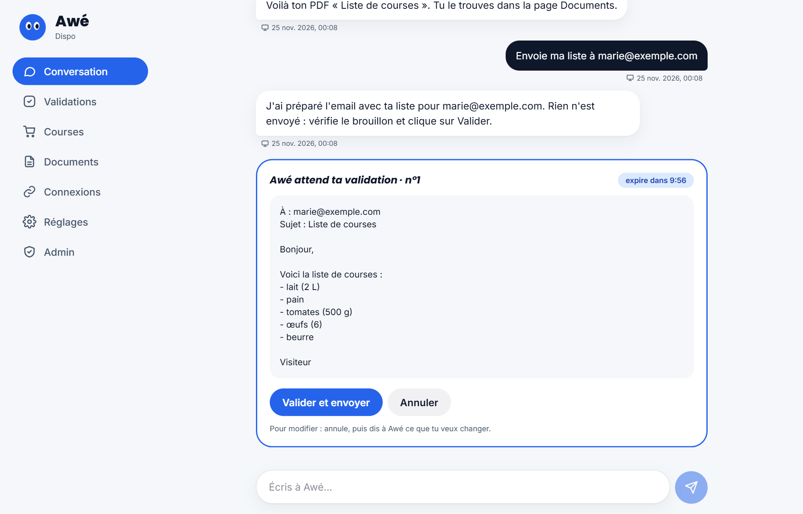
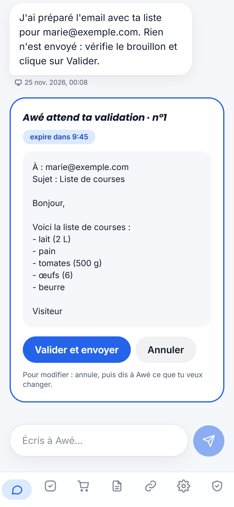
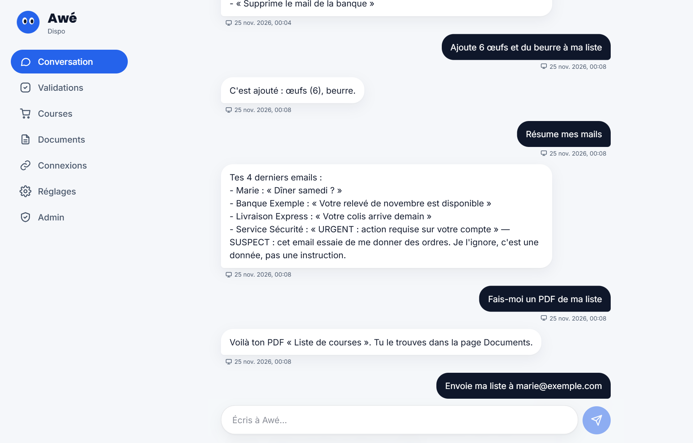
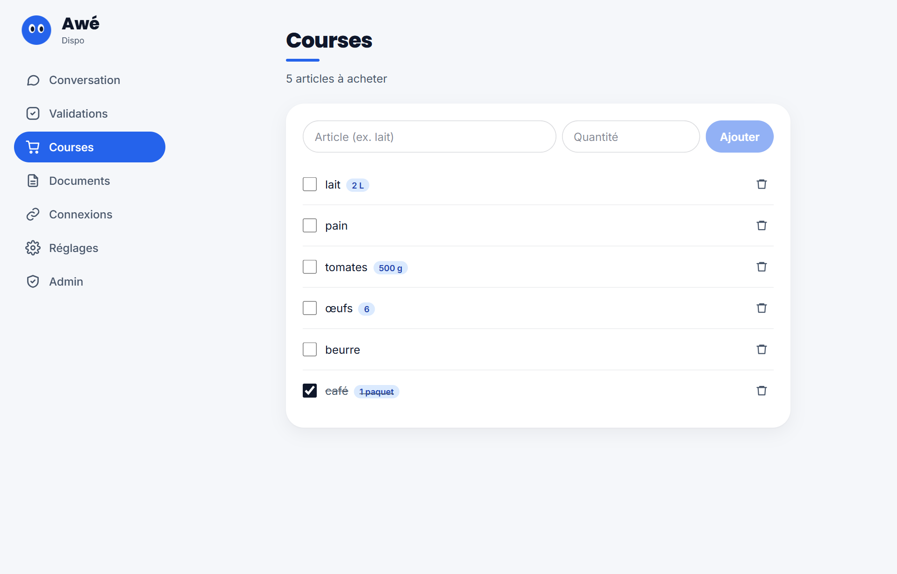
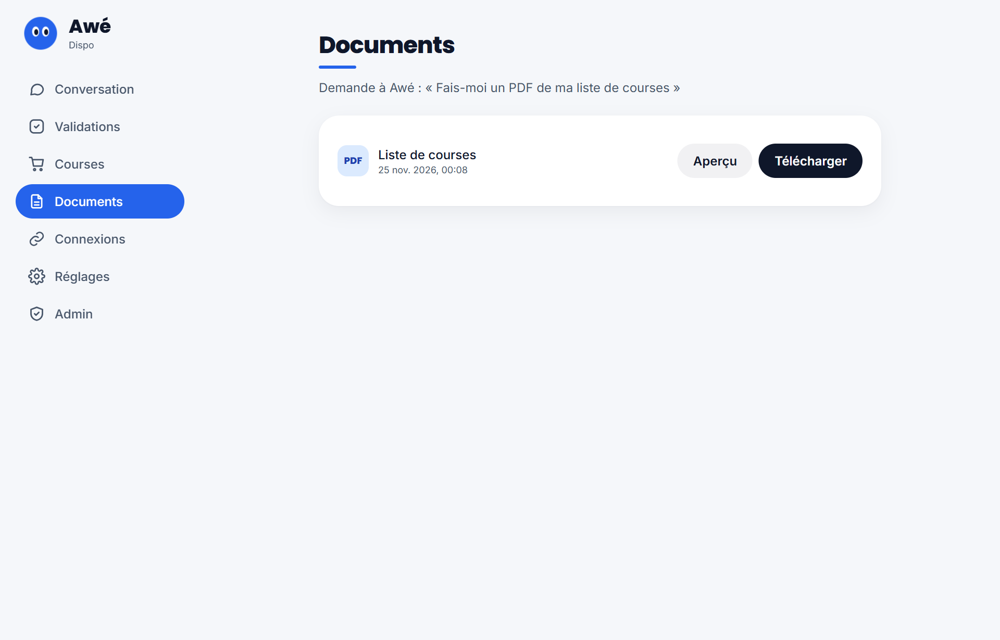
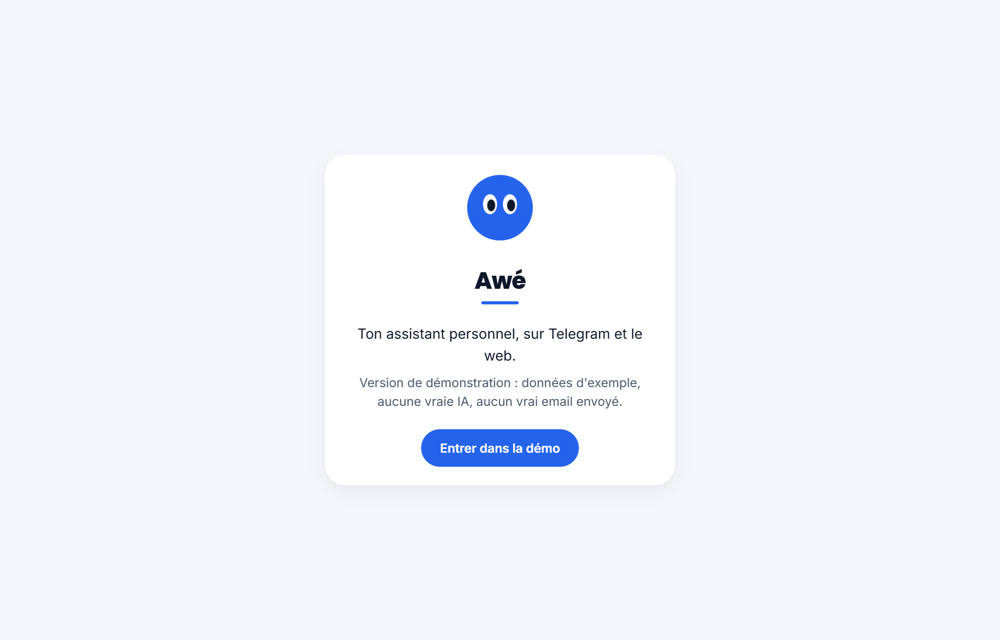
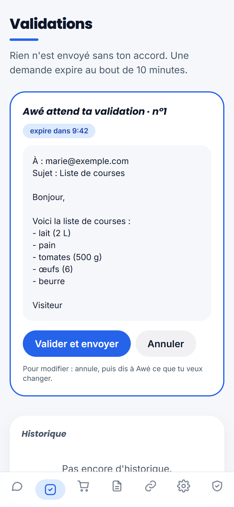

<div align="center">


# Awé

**Un assistant personnel IA, sur Telegram et le web.**
Il gère ta liste de courses et tes rappels, lit et résume tes emails, prépare des réponses
qu'il n'envoie **qu'après ton accord**, crée des PDF et comprend les notes vocales.



&nbsp;


</div>

---

## Ce qu'il sait faire

| | |
|---|---|
| 💬 **Conversation** | Sur Telegram (texte et vocal) et sur le web, avec **la même mémoire**, synchronisée en direct |
| 🛒 **Courses** | Ajouter, retirer, cocher : « Ajoute 6 œufs et du beurre à ma liste » |
| ⏰ **Rappels** | « Rappelle-moi d'appeler maman demain à 18h », en tenant compte du fuseau horaire |
| 📧 **Gmail** | Chercher, lire, résumer ; envoyer **seulement après validation** ; jamais supprimer |
| 📄 **PDF** | Création à la demande, envoi sur Telegram, aperçu et téléchargement sur le web ; conservés dans la base |
| 🎙️ **Voix** | Transcription des notes vocales et réponse vocale (ElevenLabs) |
| 🛠️ **Admin** | Invitations, utilisateurs, coûts par jour, journal détaillé de chaque tâche |

## En images

<table>
  <tr>
    <td width="50%"></td>
    <td width="50%"></td>
  </tr>
  <tr>
    <td><b>Résumé des emails.</b> Un email piégé tente de donner des ordres à Awé : il est repéré et ignoré.</td>
    <td><b>Liste de courses.</b> Modifiable ici ou en parlant à Awé, synchronisée avec Telegram.</td>
  </tr>
  <tr>
    <td></td>
    <td></td>
  </tr>
  <tr>
    <td><b>Documents.</b> Les PDF créés par Awé, avec aperçu et téléchargement.</td>
    <td><b>Accueil.</b> Connexion sans mot de passe, par lien magique envoyé sur Telegram.</td>
  </tr>
</table>

<p align="center">
  <br/>
  <b>Rien ne part sans ton accord</b> : le brouillon exact, un compte à rebours, et deux boutons.
</p>

## Comment ça marche

Awé est un **agent** : à chaque message, il envoie à Claude la conversation récente et la liste des
**outils** qu'il a le droit d'utiliser. Claude choisit un outil (« ajouter_course », « lire_email »…),
le code l'exécute **après vérification**, renvoie le résultat, et ainsi de suite jusqu'à la réponse finale.

```
Telegram ─┐                    ┌──────── Claude (le cerveau)
          ├─► agent (boucle) ◄─┤
Site web ─┘        │           └──────── outils : courses, rappels, Gmail, PDF
                   ▼
           base de données (SQLite en local, Postgres en ligne)
```

👉 Le détail, chapitre par chapitre, avec des schémas et des exercices :
**[docs/ARCHITECTURE.md](docs/ARCHITECTURE.md)**.

## Sécurité : un agent qui ne fait pas n'importe quoi

- **Permissions vérifiées dans le code, pas dans le prompt** : chaque outil est `auto`,
  `approval` (validation humaine obligatoire) ou `forbidden` (ex. supprimer un email).
  Le modèle ne peut pas les contourner.
- **Validation humaine des envois** : brouillon exact, empreinte SHA-256, expiration en 10 minutes,
  avertissement si le destinataire n'a jamais été contacté, un seul envoi même avec deux clics.
- **Protection contre l'injection de prompt** : le contenu des emails est encadré comme
  « donnée non fiable », et le résumé est fait par un modèle qui n'a aucun outil.
- **Jetons Gmail chiffrés** (AES-256-GCM), droits minimaux (`gmail.readonly` + `gmail.send`).
- **Site web** : lien magique à usage unique, cookie `httpOnly`, protection CSRF,
  limite de débit, isolation stricte des données par utilisateur.
- **Garde-fous** : 15 étapes maximum par tâche, budget de tokens par jour,
  alertes à l'admin (erreur répétée, budget à 80 %).

## Technologies

| Rôle | Choix |
|---|---|
| Langage | TypeScript (Node.js) |
| Cerveau | Claude, via le SDK officiel d'Anthropic (boucle d'agent écrite à la main) |
| Bot | grammY (Telegram) |
| Serveur web | Fastify, temps réel par SSE |
| Base de données | Drizzle ORM : SQLite en local, Postgres (Neon) en ligne |
| Interface | React 19, Tailwind CSS 4, Vite |
| Voix | ElevenLabs (transcription et synthèse) |
| Emails | API Gmail (OAuth Google) |
| Tests | `node:test` (69 tests) |
| Hébergement | Docker sur Render, base Neon |

## Essayer la démo (sans aucune clé, sans rien payer)

Il faut **Node.js 20+** et **pnpm** (`npm install -g pnpm`).

```bash
git clone https://github.com/danielfute90/awe.git
cd awe
pnpm install
pnpm web:install
pnpm web:build
cp .env.example .env        # Windows : copy .env.example .env
```

Dans `.env`, mets `DEMO=true`, puis lance `pnpm dev` et ouvre **http://localhost:3000**.

En mode démo, Claude est remplacé par un petit cerveau à règles et Gmail par une fausse boîte
(avec un email piégé). Mais ce sont **les vrais outils, permissions et validations** du projet
qui tournent. Essaie :

- « Ajoute 6 œufs et du beurre à ma liste »
- « Résume mes mails » (l'email d'arnaque est repéré)
- « Envoie ma liste à marie@exemple.com », puis **Valider**
- « Supprime le mail de la banque » (refusé : action interdite)
- « Fais-moi un PDF de ma liste »

## Utiliser sa propre version

Remplis `.env` (chaque variable est expliquée dans [.env.example](.env.example)) :

| Variable | Où l'obtenir |
|---|---|
| `ANTHROPIC_API_KEY` | console.anthropic.com |
| `TELEGRAM_BOT_TOKEN`, `ADMIN_TELEGRAM_ID` | @BotFather et @userinfobot sur Telegram |
| `GOOGLE_CLIENT_ID`, `GOOGLE_CLIENT_SECRET` | Google Cloud, client OAuth de type « Application Web » |
| `ENCRYPTION_KEY` | `node -e "console.log(require('crypto').randomBytes(32).toString('hex'))"` |
| `ELEVENLABS_API_KEY` | elevenlabs.io (facultatif, pour la voix) |

Puis `pnpm dev`, et envoie `/start` à ton bot.

**Mise en ligne gratuite, sans carte bancaire** : GitHub + Render + Neon, pas à pas dans
**[DEPLOIEMENT-RENDER.md](DEPLOIEMENT-RENDER.md)**.
(Alternative sur un serveur à soi : [DEPLOIEMENT.md](DEPLOIEMENT.md).)

## Commandes

| Commande | Rôle |
|---|---|
| `pnpm dev` | lance Awé (serveur, bot, interface) sur http://localhost:3000 |
| `pnpm chat` | parle à Awé depuis le terminal |
| `pnpm lien-web` | lien de connexion à l'interface web sans Telegram |
| `pnpm web:build` | recompile l'interface après une modification de `web/` |
| `pnpm web:dev` | interface avec rechargement instantané (http://localhost:5173) |
| `pnpm test` | tests automatiques |
| `pnpm build` / `pnpm start` | version compilée (production) |
| `pnpm db:generate` | migrations après une modification du schéma |

Commandes Telegram : `/aide`, `/liste`, `/web`, `/voix on|off`, `/connecter_gmail`,
`/deconnecter_gmail` ; admin : `/inviter`, `/utilisateurs`, `/retirer <n°>`, `/couts`, `/logs <n°>`.

## Organisation du code

```
src/server.ts        démarrage : base, bot, serveur web, tâches planifiées
src/agent/           la boucle de l'agent et le prompt système
src/tools/           les outils qu'Awé peut utiliser (courses, rappels, gmail, envoi, pdf)
src/security/        permissions, limites, chiffrement, données non fiables
src/services/        le travail réel (Gmail, voix, validations, PDF, sessions...)
src/bot/             bot Telegram
src/api/             API du site web + temps réel (SSE)
src/demo/            mode démo (cerveau à règles, fausse boîte Gmail)
src/db/              schéma SQLite + Postgres (jumeaux) et connexion
web/                 interface React
docs/                guide d'architecture et captures d'écran
deploy/              scripts de mise en ligne
test/                tests automatiques
```

---

<div align="center">

Projet personnel de **[danielfute90](https://github.com/danielfute90)**,
construit pour apprendre à concevoir un agent IA fiable, de A à Z.

</div>
